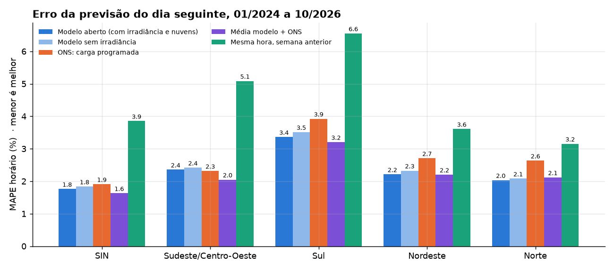
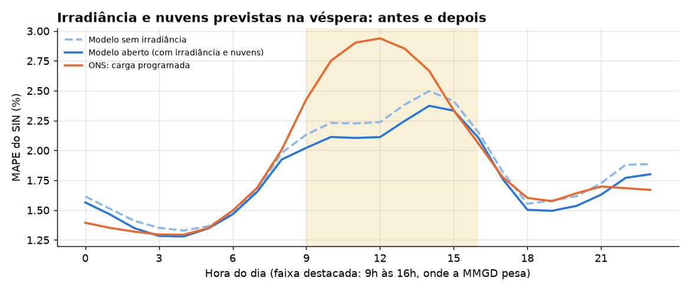
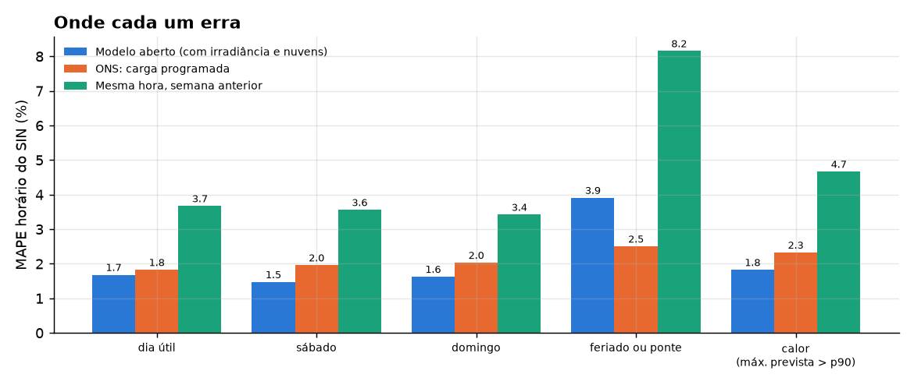
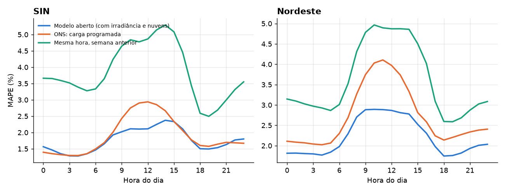
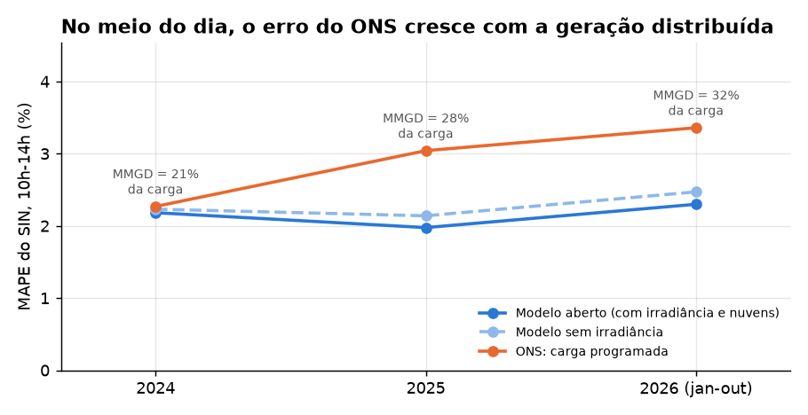
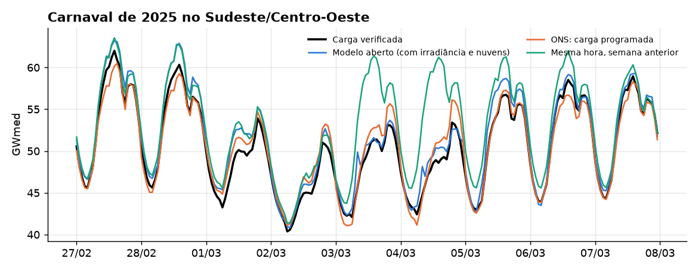

# Previsão de carga do dia seguinte: modelo aberto × ONS

[](https://github.com/CaioNepomuceno2/ons-load-forecast/actions/workflows/ci.yml)


**Um modelo feito só com dados abertos consegue prever a carga de amanhã tão bem quanto o ONS?**

Toda manhã o Operador Nacional do Sistema Elétrico programa a operação do dia seguinte a partir de uma
carga programada, hora a hora, para cada subsistema. Comparei essa carga programada com um modelo
LightGBM que usa apenas o que estaria disponível na véspera: carga verificada, previsão de temperatura,
previsão de irradiância e nuvens e calendário. O teste cobre **34 meses fora da amostra (jan/2024 a
out/2026), cerca de 25 mil horas por subsistema**, com o modelo retreinado mês a mês.

## Resultado

| MAPE horário, jan/2024 a out/2026 | Modelo aberto (com irradiância) | Mesmo modelo, sem irradiância | ONS (programada) | Média modelo + ONS | Mesma hora na semana anterior |
|---|---|---|---|---|---|
| **SIN** | 1,76% | 1,84% | 1,91% | **1,63%** | 3,85% |
| Sudeste/Centro-Oeste | 2,36% | 2,42% | 2,32% | **2,05%** | 5,09% |
| Sul | 3,36% | 3,51% | 3,92% | **3,20%** | 6,55% |
| Nordeste | 2,21% | 2,33% | 2,71% | **2,20%** | 3,61% |
| Norte | **2,03%** | 2,08% | 2,63% | 2,12% | 3,15% |

A "média modelo + ONS" usa o modelo com irradiância. Tabelas completas em `reports/mape_geral.csv`.



* **No SIN, o modelo fica um pouco à frente do ONS, mas ainda sem significância.** A diferença de 1,76% para
  1,91% tem p = 0,086 no teste de Diebold-Mariano sobre o erro diário. Sem a irradiância era 1,84% (p = 0,37).
  No Sudeste/Centro-Oeste, o ONS continua um pouco à frente (2,32% contra 2,36%; p = 0,68).
* **No Sul, no Nordeste e no Norte, o modelo erra menos que o ONS**, com significância (p < 0,001 nos três).
* **A média simples entre modelo e ONS é o melhor resultado em quatro das cinco áreas**: no SIN, o erro cai
  15% em relação ao ONS sozinho (1,63% contra 1,91%; p < 10⁻⁹). Os dois erram em lugares diferentes, então
  a combinação aproveita o melhor de cada um. Na prática, a carga programada poderia entrar como mais uma
  feature ou numa média, sem trocar o processo do ONS.
* Os dois ficam muito à frente da regra ingênua "repetir a semana passada" (3,85% no SIN).

**O que isso significa:** com uma carga média de 81,5 GW no SIN, cada ponto de MAPE é da ordem de 800 MW.
A média modelo + ONS erra, em média, **234 MW a menos por hora** que o ONS sozinho (1.355 contra 1.589 MW).
Um modelo aberto, que roda em um notebook, já serve como segunda opinião útil para a programação.

### Irradiância e nuvens: antes e depois

A versão anterior deste projeto listava a falta de irradiância e nebulosidade como o próximo passo natural.
Eu o testei: o modelo ganhou a previsão de radiação de onda curta e de cobertura de nuvens do Open-Meteo,
emitida na véspera, para os mesmos centros de carga e com os mesmos pesos da temperatura. As variantes, as
janelas e a regra de decisão foram escritas e commitadas antes de rodar o backtest
([`docs/preregistro_irradiancia.md`](docs/preregistro_irradiancia.md)). A regra foi cumprida, e o modelo com
irradiância virou o "Modelo aberto" deste README. Todos os números abaixo saem de
`reports/irradiancia_*.csv` e `reports/diebold_mariano.csv`.

| MAPE horário do SIN | Sem irradiância | Com irradiância | Variação | ONS |
|---|---|---|---|---|
| jan/2024 a out/2026, todas as horas | 1,84% | 1,76% | −0,08 pp (−4,1%) | 1,91% |
| jan/2024 a out/2026, 9h às 16h | 2,28% | 2,18% | −0,11 pp (−4,7%) | 2,62% |
| fev/2025 a out/2026, todas as horas | 1,82% | 1,70% | −0,12 pp (−6,5%) | 2,05% |
| fev/2025 a out/2026, 9h às 16h | 2,26% | 2,11% | −0,15 pp (−6,6%) | 2,86% |

Por subsistema (jan/2024 a out/2026, todas as horas). O p é do Diebold-Mariano sobre o erro diário:

| Área | Sem irradiância | Com irradiância | p (com × sem) | ONS | p (com × ONS) |
|---|---|---|---|---|---|
| SIN | 1,84% | 1,76% | 0,0001 | 1,91% | 0,086 |
| Sudeste/Centro-Oeste | 2,42% | 2,36% | 0,026 | 2,32% | 0,68 |
| Sul | 3,51% | 3,36% | < 0,0001 | 3,92% | 0,0003 |
| Nordeste | 2,33% | 2,21% | 0,0004 | 2,71% | < 0,0001 |
| Norte | 2,08% | 2,03% | 0,003 | 2,63% | < 0,0001 |



Erro do SIN nas horas em que a MMGD pesa (jan/2024 a out/2026):

| Hora | Sem irradiância | Com irradiância | ONS |
|---|---|---|---|
| 9h | 2,13% | 2,02% | 2,43% |
| 10h | 2,23% | 2,11% | 2,75% |
| 11h | 2,23% | 2,10% | 2,90% |
| 12h | 2,24% | 2,11% | 2,94% |
| 13h | 2,38% | 2,25% | 2,85% |
| 14h | 2,50% | 2,37% | 2,67% |
| 15h | 2,41% | 2,33% | 2,33% |
| 16h | 2,15% | 2,11% | 2,06% |

No Diebold-Mariano das 9h às 16h, o modelo com irradiância erra menos que o sem irradiância (p < 0,0001) e
menos que o ONS (p = 0,002); o modelo sem irradiância já erra menos que o ONS nessas horas (p = 0,013).

**O que a irradiância fez e o que não fez**

* **Melhorou todas as áreas, com significância**, e o ganho no SIN é de 0,08 ponto percentual (4%) na janela
  toda e de 0,12 (6,5%) desde fev/2025. Cresce com o tempo porque a previsão de irradiância só existe a partir
  de 19/01/2024: o treino de 2022 e 2023 não a tem, e o modelo de cada mês aprende com os meses anteriores.
* **Não é só efeito solar.** O ganho do SIN aparece em todas as horas: de 0,11 a 0,14 ponto entre 9h e 14h, de
  0,05 a 0,07 de 0h a 4h e de 0,08 a 0,11 de 19h a 23h. À noite a MMGD é zero, então o ganho não vem só de
  prever a MMGD. As colunas que o modelo mais usa são as médias diárias de irradiância e de nuvens
  (`reports/importancia_features_irr.json`), o que sugere que elas funcionam como indicador do tipo de tempo
  (frente fria, chuva, umidade) além do efeito solar. **O mecanismo não foi isolado.**
* **O ganho é do conjunto de colunas, não só da previsão.** O conjunto inclui a irradiância observada em D-2
  (`ghi_lag2`), que já é passado na véspera, e a diferença entre a previsão de D e ela.
* **Não ajuda nos feriados** (3,91% contra 2,50% do ONS no SIN, praticamente igual ao de antes) e o ONS
  continua melhor de 0h a 2h, às 16h e às 22h e 23h.
* **Dois controles.** (1) `modelo_irr_estrito` usa a previsão `previous_day2`, feita cerca de 48 h antes e
  seguramente anterior à programação: 1,76% no SIN, igual ao de `previous_day1`. O ganho não depende de
  previsões publicadas depois do meio-dia de D-1. (2) `modelo_irr_embaralhado` tem as mesmas colunas, com a
  irradiância de outro dia (37 dias antes): 1,82%, ou seja, −0,02 ponto contra −0,08 do modelo real (p = 0,16).
  Ter mais colunas explica menos de um quarto do ganho. O controle não é nulo em tudo: das 9h às 16h ele
  melhora 0,035 ponto no SIN (p = 0,038), contra 0,108 do modelo real.

### Onde cada um erra



* **O ONS ganha nos feriados e pontes** (2,5% contra 3,9% no SIN). O modelo viu poucos exemplos de cada
  feriado (de dois a quatro de cada no treino), e é aí que a experiência de quem programa faz diferença.
* **O modelo ganha nos fins de semana e nos dias quentes.** Nos 10% de dias com a maior máxima prevista, o
  erro do SIN é de 1,8% contra 2,3% do ONS.
* **O ONS ganha na madrugada (0h a 2h), às 16h e no fim da noite (22h e 23h); o modelo ganha nas demais
  horas**, com a maior folga no meio do dia.



### No meio do dia, o erro do ONS cresce com a geração distribuída

A carga global inclui a estimativa de micro e minigeração distribuída (MMGD, basicamente solar nos
telhados). Entre 10h e 14h, a MMGD saiu de 21% da carga do SIN em 2024 para 32% em 2026. No mesmo período,
o MAPE do ONS nesse horário subiu de 2,3% para 3,4%, enquanto o do modelo com irradiância ficou entre 2,0% e
2,3%:

| SIN, 10h-14h | MMGD / carga | Modelo com irradiância | Modelo sem irradiância | ONS |
|---|---|---|---|---|
| 2024 | 21% | 2,18% | 2,23% | 2,27% |
| 2025 | 28% | 1,98% | 2,14% | 3,04% |
| 2026 (jan-out) | 32% | 2,30% | 2,47% | 3,36% |



Leia isso com cuidado: a parcela de MMGD da carga verificada também é uma **estimativa** do ONS, revisada
depois do fato. Parte desse erro pode vir de mudanças na estimativa, e não da previsão em si (ver
Limitações). Mesmo assim, é no horário solar que o ONS mais perdeu precisão, e é onde o modelo ganha dele
por mais folga. A irradiância recuperou parte do erro de 2026, que ainda é maior que o de 2025.

### Exemplo: Carnaval de 2025



A regra "repetir a semana passada" erra 11,5% na segunda e 14,3% na terça de Carnaval (MAPE do dia). O
modelo erra 1,5% e 2,1%, e o ONS, 2,8% e 3,1%. Na Quarta-feira de Cinzas, que tem meia jornada, o ONS acerta
em cheio (0,5%) e o modelo erra 3,2% (2,7% sem a irradiância). Valores em `reports/carnaval_2025.csv`.

## Na prática: o que muda para quem decide

### O problema hoje
* **Quem programa a operação (ONS e agentes):** a carga programada erra mais justamente onde o sistema está
  mudando. Entre 10h e 14h, o MAPE do ONS no SIN subiu de 2,3% (2024) para 3,4% (2026), enquanto a geração
  distribuída foi de 21% para 32% da carga nesse horário. Em 2026, o erro médio do ONS nesse horário foi de
  2.943 MW por hora.
* **Distribuidoras:** precisam prever a própria carga para comprar energia, contratar uso da rede e operar.
  A MMGD dos telhados, que elas não medem em tempo real, torna a carga do meio do dia mais difícil de prever.
* **Comercializadoras e consumidores livres:** a carga do sistema move o preço de curto prazo; prever melhor
  a carga é prever melhor o despacho.

### O que se ganha

| Ganho | Quanto (SIN, jan/2024 a out/2026) | De onde vem o número |
|---|---|---|
| Erro médio menor usando a média modelo + ONS | **1.355 contra 1.589 MW por hora (−234 MW, −15%)** | **Medido** fora da amostra (`reports/mape_geral.csv`, `reports/aplicacao.json`) |
| Menos horas de erro grande (acima de 5% da carga) | **767 contra 1.471 horas (−48%)** | **Medido** (`reports/aplicacao.json`) |
| Erro de cauda menor (percentil 95 do erro horário) | **3.758 contra 4.522 MW (−764 MW)** | **Medido** (`reports/aplicacao.json`) |
| Erro menor no meio do dia, onde a MMGD pesa | 2026, 10h-14h: modelo 2.003 MW contra ONS 2.943 MW por hora | **Medido** (`reports/aplicacao.json`) |
| Erro menor no Sul, Nordeste e Norte com o modelo sozinho | MAPE de 3,36%, 2,21% e 2,03% contra 3,92%, 2,71% e 2,63% do ONS, com significância | **Medido** (Diebold-Mariano em `reports/diebold_mariano.csv`) |

O ganho está em MW, não em R$: converter erro de previsão em custo exige o custo de reserva e de
redespacho de cada hora, que não estão nos dados usados aqui. O que dá para dizer é a direção: erro de
cauda menor reduz a reserva necessária para cobrir os desvios, e menos horas de erro grande significam menos
ajustes de despacho fora da programação.

### Por que aplicar
* **O problema vai crescer:** a MMGD ao meio-dia já é estimada em 30% a 43% da carga dos subsistemas em 2026
  (`docs/dados.md`). O erro do ONS no meio do dia acompanha esse crescimento.
* **Os dois métodos erram em lugares diferentes:** o ONS ganha em feriados e de madrugada; o modelo ganha nos
  fins de semana, nos dias quentes e no meio do dia. Por isso a média dos dois é melhor que qualquer um em
  quatro das cinco áreas. Combinar não exige trocar o processo de quem programa, só acrescentar uma previsão.
* **Custo baixo e auditável:** dados abertos, código aberto, retreino mensal em minutos por subsistema.

### Como aplicar (roteiro de adoção)
1. **Dados que melhoram o resultado:** medição de carga em tempo real (em vez da série revisada), uma estimativa
   própria de MMGD, previsão de irradiância e nuvens por ponto de MMGD instalada (o teste aqui usa a previsão
   aberta do Open-Meteo em poucos centros de carga e já ganhou 0,08 ponto no SIN) e os feriados estaduais e
   municipais da área. Para uma distribuidora, a carga da própria área de concessão substitui a do subsistema.
2. **Recalibrar:** rodar `scripts/build_dataset.py` e `scripts/backtest.py` com a nova série; o retreino é
   mensal e por área.
3. **Piloto de 3 meses em paralelo:** gerar a previsão todo dia, sem mudar nada no processo, e comparar o
   MAPE e as horas de erro acima de 5% do modelo, da previsão atual e da média dos dois.
4. **Rotina diária:** às 10h de D-1, o robô baixa a carga verificada até aquele horário e as previsões de
   temperatura, irradiância e nuvens, gera a previsão hora a hora de D, grava em Parquet e publica num painel
   (Power BI ou Streamlit) ao lado da previsão oficial, com alerta nas horas em que as duas divergem muito.
   Quem usa: programação da operação, compra de energia e trading.
5. **Critério de sucesso:** a média modelo + previsão atual reduz o MAPE e as horas de erro grande no
   piloto, como reduziu no backtest (−15% de erro médio e −48% das horas de erro grande no SIN).

### Limites de uso
* Não usar o modelo sozinho em feriados e pontes: ali o ONS é bem melhor (2,5% contra 3,9% no SIN).
* O modelo sozinho tem cauda pior que o ONS no percentil 99 (7.628 contra 6.629 MW no SIN), por causa dos
  feriados. A versão recomendada é a média com a previsão oficial, que fica melhor também na cauda
  (5.937 MW).
* O backtest usa a carga verificada já revisada; em produção, com dados preliminares, o ganho tende a ser
  menor (ver Limitações).
* Não é uma previsão de preço nem de despacho; é a entrada desses processos.

A metodologia completa, com fórmulas, desenho do backtest e premissas, está em
[`docs/metodologia.md`](docs/metodologia.md).

## Quanto vale cada informação

| SIN, MAPE | |
|---|---|
| Modelo só com carga até D-2, temperatura prevista e calendário | 1,97% |
| + carga da madrugada e da manhã de D-1 (00h-10h) | 1,84% |
| **+ irradiância e nuvens previstas na véspera** | **1,76%** |
| Com a temperatura observada no lugar da prevista (oráculo, não é previsão) | 1,67% |
| Com temperatura, irradiância e nuvens observadas (oráculo, não é previsão) | 1,62% |

A carga da manhã de D-1 vale 0,13 ponto percentual. Ela entra na versão principal porque o ONS também a tem
quando programa o dia seguinte, por volta do meio-dia. Sem ela, o modelo sem irradiância fica a 0,06 ponto do
ONS no SIN. A irradiância e as nuvens previstas valem 0,08 ponto com a carga da manhã e 0,07 sem ela (1,89%).
A diferença para o último oráculo (0,14 ponto) mostra quanto se ganharia com uma previsão de tempo perfeita.

## Como funciona

```
API de carga do ONS ─► carga verificada (semi-horária) ─┐
Open-Meteo, rodada da véspera ─► temperatura prevista ──┤
Open-Meteo, rodada da véspera ─► irradiância e nuvens ──┼─► features do dia D vistas na manhã de D-1 ─► LightGBM por subsistema
feriados nacionais, pontes, Carnaval ───────────────────┘                (retreino mensal)                     │
API de carga do ONS ─► carga programada ─────────────────────────────────────────────────────────────► comparação hora a hora
```

* **Alvo:** carga global verificada (`val_cargaglobal`), em média horária, dividida pela média dos 7 dias
  de D-8 a D-2. O modelo aprende a forma relativa e não o nível absoluto, o que ajuda com o crescimento da
  carga ao longo dos anos. A perda é L1, alinhada ao erro percentual.
* **Features:** mesma hora em D-2, D-3, D-7, D-14, D-21 e D-28; média das últimas 4 semanas; carga de 00h a
  10h de D-1; temperatura prevista hora a hora e máxima e média do dia, ponderadas pela população dos
  centros de carga de cada subsistema; irradiância e nuvens previstas hora a hora e médias do dia, com o
  mesmo ponderador, mais a irradiância observada em D-2 e a diferença para a prevista; feriado, ponte,
  véspera, pós-feriado e fim de ano, inclusive nos dias usados como lag.
* **Sem vazamento:** o modelo usado no mês M é treinado só com dias alvo até dois dias antes do início de
  M. Os testes em [`tests/test_features.py`](tests/test_features.py) alteram a carga de D-1 (depois das
  10h) e de D e verificam que nenhuma feature muda. Os testes em
  [`tests/test_irradiancia.py`](tests/test_irradiancia.py) fazem o mesmo com a irradiância e as nuvens:
  alteram a rodada mais recente de D e D-1, as previsões dos outros dias e o carimbo da meia-noite de D+1, e
  verificam que nenhuma feature de D muda, e que só variáveis `previous_dayN` com N ≥ 1 são usadas como
  previsão.

## Decisões de dados

Os detalhes estão em [`docs/dados.md`](docs/dados.md). Os principais:

* **Mesma definição de carga.** A carga programada corresponde à **carga global com MMGD**
  (`val_cargaglobal`), e não à parcela supervisionada nem à carga sem MMGD. Comparada com a carga sem MMGD,
  a programada erraria 13% em 2025; com a carga global, erra 3% na média semi-horária.
* **Fuso e intervalo.** A API marca o **fim** de cada meia hora em UTC. Converti para o início do intervalo
  em horário de Brasília (UTC-3, sem horário de verão desde 2019) e só usei horas com as duas metades
  presentes.
* **JSON inválido.** A API devolve campos vazios (`"val_cargammgd": ,`) em anos antigos. O parser trata
  isso explicitamente, com teste.
* **Temperatura prevista, não observada.** O INMET não estava acessível do ambiente de execução. Usei a
  [Previous Runs API do Open-Meteo](https://open-meteo.com/en/docs/previous-runs-api)
  (`temperature_2m_previous_day1`): o valor previsto para cada hora cerca de 24 horas antes. O Open-Meteo
  descarta as primeiras 24 horas de cada rodada, então a rodada saiu em D-1 ou antes, nunca em D.
* **Irradiância e nuvens previstas.** Mesma API e mesma lógica (`shortwave_radiation_previous_day1` e
  `cloud_cover_previous_day1`), mesmos centros de carga e mesmos pesos. Só existem a partir de 19/01/2024.
  A radiação é a média da hora anterior ao carimbo; a hora de carga usa o carimbo seguinte, sem cruzar a
  meia-noite.
* **Hora de emissão.** `previous_day1` garante só que a rodada saiu em D-1 ou antes. Para a tarde de D, ela
  foi publicada depois do meio-dia de D-1, quando o ONS programa (o mesmo vale para a temperatura). A variante
  estrita, com `previous_day2`, dá o mesmo resultado no SIN (1,76%).

## Reproduzir

```bash
pip install -e ".[dev]"
python scripts/download_ons.py        # carga programada e verificada, 2020 em diante (cache mensal)
python scripts/download_weather.py    # temperatura, irradiância e nuvens do Open-Meteo (cache por ano)
python scripts/build_dataset.py       # base horária e matriz de features
python scripts/backtest.py            # oito variantes, retreino mensal (~20 min cada, 1 thread)
python scripts/avaliar.py             # métricas, Diebold-Mariano, tabelas em reports/
python scripts/comparar_irradiancia.py  # antes/depois da irradiância, por janela e por hora
python scripts/make_figures.py
python scripts/aplicacao.py           # números de apoio da seção "Na prática"
pytest
```

## Estrutura

```
src/loadfc/
  ons.py          API de carga do ONS: download com cache, parser tolerante, semi-hora -> hora local
  weather.py      temperatura, irradiância e nuvens previstas na véspera (Open-Meteo), média ponderada
                  por subsistema
  calendario.py   feriados nacionais, Carnaval, pontes, vésperas, fim de ano
  features.py     matriz do dia D com o que se sabe na manhã de D-1
  model.py        LightGBM por subsistema, backtest com retreino mensal, baselines
  metricas.py     MAPE, MAE e Diebold-Mariano com variância HAC
  comparacao.py   antes/depois de uma variante: janelas, faixa de horas e Diebold-Mariano
scripts/          download_ons, download_weather, build_dataset, backtest, avaliar, comparar_irradiancia,
                  make_figures, aplicacao
reports/          tabelas (CSV/JSON) e figuras
docs/             dados.md, metodologia.md e preregistro_irradiancia.md (plano do experimento de irradiância)
```

## Limitações

* **A carga programada não é uma previsão pura.** Ela é o insumo da programação diária e pode incorporar
  ajustes operativos. Mesmo assim, é a referência oficial de carga para o dia seguinte e o benchmark natural.
* **Dados revisados.** A carga verificada é revisada depois do fato (há registros de 2025 atualizados em
  2026). O modelo usa a série revisada como lag, enquanto o ONS programou com dados preliminares. Isso
  favorece o modelo, numa medida que não dá para quantificar com os dados públicos. Em 06/11/2026, o
  pipeline foi rodado de novo com o código anterior e reproduziu as tabelas commitadas sem diferença
  (só o último dígito de alguns p-valores), então não houve revisão visível nesse período entre a primeira
  versão e esta.
* **A MMGD é estimada.** A parcela de geração distribuída na carga verificada é uma estimativa do ONS. Parte
  do erro do ONS no meio do dia pode refletir mudanças nessa estimativa, e não erro de previsão. O mesmo vale
  para o ganho da irradiância ao meio-dia: o modelo pode estar prevendo a estimativa de MMGD do ONS, que é
  calculada a partir de irradiância.
* **Irradiância e nuvens: o que o teste cobre.**
  * A previsão só existe no Open-Meteo a partir de 19/01/2024, então o treino de 2022 e 2023 não a tem e os
    primeiros meses de 2024 aprenderam pouco com ela. O ganho medido na janela toda (−0,08 ponto no SIN) é
    menor que o de fev/2025 em diante (−0,12).
  * Os pesos são de população, não de MMGD instalada, e há de 3 a 6 pontos por subsistema. A potência
    instalada por estado (dados abertos da ANEEL) seria um ponderador melhor e não foi testada.
  * O ganho aparece também à noite, então não é só efeito solar, e o mecanismo não foi isolado. O controle com
    a irradiância de outro dia não é nulo (−0,02 ponto no SIN, p = 0,16).
  * Umidade e vento continuam fora do modelo.
* **A carga da manhã de D-1** entra como se já estivesse disponível às 10h. O ONS tem a carga supervisionada
  em tempo real, mas a carga global completa (com a não supervisionada e a MMGD) só é consolidada depois.
* **Temperatura, irradiância e nuvens:** cerca de 5% das horas de 2024 não têm a previsão da véspera no
  Open-Meteo (o LightGBM trata como ausente). Para a tarde de D, a previsão `previous_day1` foi publicada
  depois do meio-dia de D-1 (a versão estrita com `previous_day2` dá o mesmo resultado). A ponderação por
  população é simples e fixa.
* **Feriados regionais** não entram, só os nacionais e o Carnaval.

---
Autor: **Caio Nepomuceno**. Dados públicos do ONS e previsões do Open-Meteo (CC BY 4.0). Projeto
independente, sem vínculo com o ONS.
